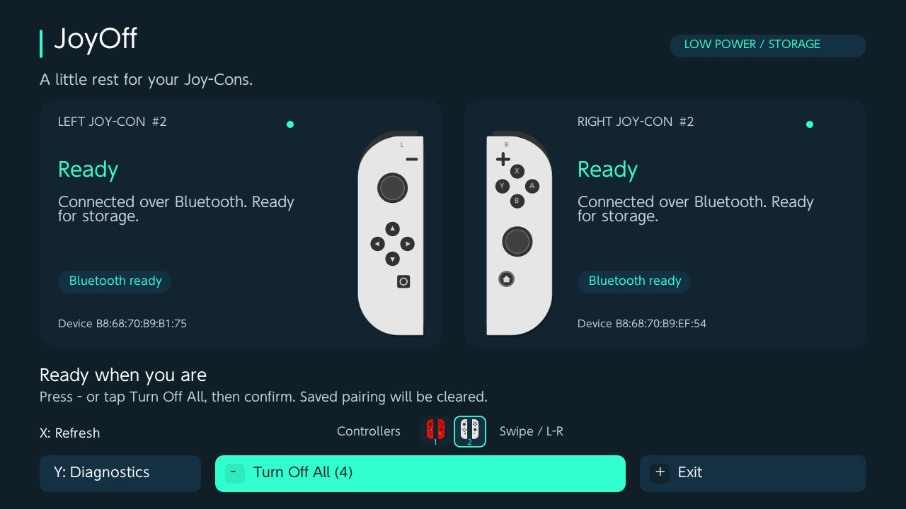
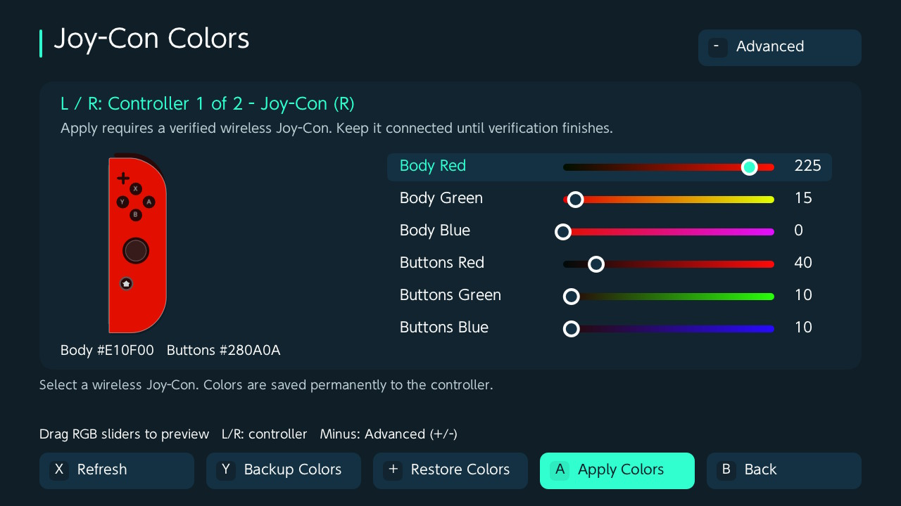

# JoyOff 1.5.0

A simple Nintendo Switch homebrew app that puts original Joy-Con controllers into shipment low-power mode and disconnects them, ready for long-term shelf storage. It also changes, backs up, and restores Joy-Con body and button colors. No PC required.



## Features

- Automatic detection of connected wireless Joy-Con L/R controllers.
- Individual controller colors, connection states, and operation results.
- Multiple controller pages with a miniature Joy-Con legend, L/R navigation, and touch swipes.
- Turn off all ready controllers across every page with one confirmation.
- Change body and button colors with touch RGB sliders and a live Joy-Con preview.
- Advanced RGB controls with +/- buttons and numeric keyboard input (0-255).
- Back up colors to SD and restore them through a file browser, with controller matching and confirmation.
- Automatic color backup before writing and SPI read-back verification afterward.
- Touch controls remain available after the controllers disconnect.
- Optional TXT diagnostics saved to `sdmc:/joyoff-debug.txt`; logging is off by default.

## Requirements

- A Nintendo Switch running custom firmware and firmware 13.0.0 or newer.
- Original Joy-Con L/R controllers connected wirelessly.
- Homebrew Menu in full application mode (title override).

MissionControl is not required. Pro Controllers, Joy-Con 2, and third-party controllers are outside the scope of this app.

## Usage

1. Extract the release ZIP to the SD card root (it contains only `switch/JoyOff.nro`) and launch JoyOff through the Homebrew Menu.
2. Detach your Joy-Cons and connect them wirelessly. Detection refreshes automatically.
3. Press **Minus (-)** or tap **Turn Off All**, then confirm.
4. Check the per-controller results. Use the touchscreen to exit after the controllers disconnect.

**Saved Bluetooth pairing will be cleared.** JoyOff resets pairing, enables shipment low-power mode, and disconnects the controllers. Attach them to a Switch to wake and pair again. If an operation fails partway through, pairing may already have been cleared; check each controller's result.

Home screen controls:

| Control | Action |
| --- | --- |
| Minus (-) | Open the Turn Off All confirmation / confirm |
| B / Plus (+) | Cancel, return, or exit |
| X | Refresh detection |
| Y | Open diagnostics |
| ZL | Open Colors |
| ZR | Open About |
| Minus (-), in Diagnostics | Enable / disable TXT logging while idle |
| L / R | Previous / next controller page |
| Touch | Buttons, miniature page legend, and horizontal page swipes |

Controller pages group left and right devices for display; they do not establish controller pairs. Colors come from stored HID color information and may differ from replacement shells.

TXT logging is off at each launch. Open Diagnostics, press Minus or tap the logging toggle to enable it, then use X / Refresh to capture discovery. Disabling logging leaves existing log files intact.

## Joy-Con colors



### Change colors

Open **Colors** with **ZL** or the footer touchscreen button. Select a controller with **L/R**, then drag the body and button RGB sliders to preview the colors. Use **Minus / Advanced** for numeric **+/-** controls; toggle back with **Minus / Sliders**. **Up/Down** selects a channel, **Left/Right** adjusts it by 1, and **ZL/ZR** adjusts it by 16. Switching modes preserves the selected colors. Press **A / Apply Colors**, then confirm.

In Advanced mode, tap a numeric value to open the numeric keyboard with its current value. Enter a number from **0 to 255**; invalid values must be corrected before acceptance, and cancelling preserves the previous value. Keyboard input updates the preview only; saving to the Joy-Con still requires Apply and confirmation.

### Backup colors

Use **Y / Backup Colors** to save the selected wireless Joy-Con's current body and button colors before editing. This reads the colors directly from SPI, saves them to SD, and verifies the backup file without writing to the controller. The result and backup path appear in the Colors menu. Apply also retains its automatic backup before writing.

### Restore colors

1. Select the wireless Joy-Con to restore, then press **Plus / Restore Colors**.
2. Choose its original JoyOff backup `.bin` file in the file browser.
3. Review the color preview and press **A / Confirm Restore**.
4. Wait for the backup of current colors, restore, and SPI read-back verification to finish. **No additional Apply is needed.** Cancel returns to the previous color preview.

The browser starts at `/switch/JoyOff/` (or the SD root if that folder is unavailable). Browse folders and `.bin` files using touch or **Up/Down**, **A** to open/select, **X** for the parent folder, **L/R** for previous/next pages, and **B** to cancel.

Keep each backup's original filename: it contains the Bluetooth address and RGB bytes used to check the file against the selected Joy-Con. Backup files contain six bytes of color data; the controller address is stored in the filename. The file is checked again when Restore is confirmed.

Apply and Restore require a verified Joy-Con connected over Bluetooth. Detach attached controllers and use **X / Refresh**. The app backs up the original six color bytes to `/switch/JoyOff/colors-<Bluetooth address>-<original RGB bytes>.bin` before writing, then reads the colors back from SPI to verify them. If backup fails, no write is sent. These files contain colors only, not a full SPI backup. Reconnect the Joy-Con if the system still displays its previous colors.

## Build

Requires devkitPro/devkitA64, libnx, deko3d, GLM headers, and `uam`. The NanoVG/deko3d renderer is included.

```sh
make -j4 release
```

The output includes `JoyOff.nro`, `JoyOff-1.5.0.zip` containing only `switch/JoyOff.nro`, and `JoyOff-1.5.0-source.zip` with the corresponding sources and license notices. See the [technical README](docs/technical.md) for implementation details and diagnostic information.

## Credits and license

The Switch application is distributed under [LGPLv3](COPYING), with the accompanying [GPLv3 terms](COPYING.GPL). Graphics initialization and UI helpers are adapted from Switch 90DNS Tester by Nexrem and contributors. Bundled NanoVG/deko3d code retains its original notices and credits Adubbz, Mikko Mononen, and fincs.

Joy-Con illustrations are adapted from [0 Noctis 0's Wikimedia illustration](https://commons.wikimedia.org/wiki/File:Nintendo_Switch_Joy-Con_illustration.svg), licensed CC BY-SA 4.0. See [art attribution](COPYING.ART).

Protocol and implementation references include [jc_toolkit](https://github.com/CTCaer/jc_toolkit), [dekuNukem's reverse-engineering notes](https://github.com/dekuNukem/Nintendo_Switch_Reverse_Engineering), [libnx](https://github.com/switchbrew/libnx), and [MissionControl](https://github.com/ndeadly/MissionControl).

The color SPI read/write implementation is adapted from CTCaer's jc_toolkit for JoyOff's Bluetooth transport. Its MIT notice is included in [COPYING.JCTOOLKIT](COPYING.JCTOOLKIT).

## Support My Work

If you find this project useful, please consider supporting me by buying me a coffee!

<a href="https://www.buymeacoffee.com/sthetixofficial" target="_blank">
  
</a>
